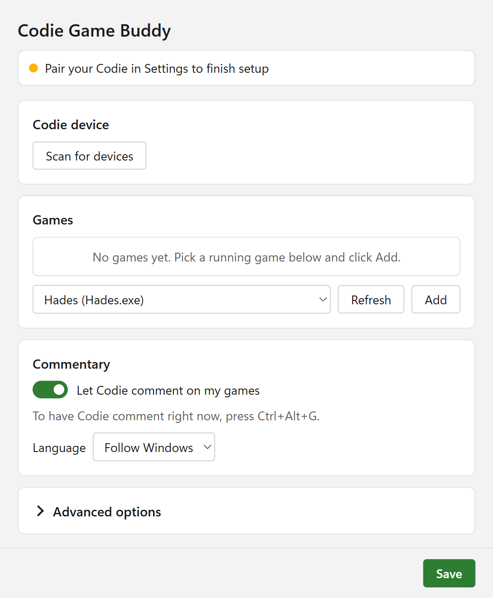
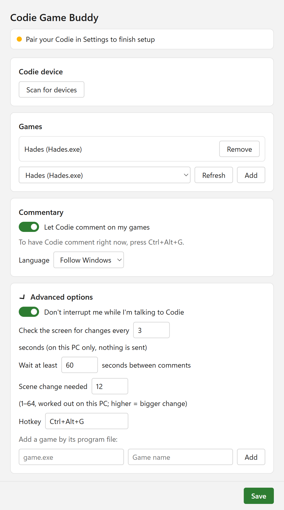

# Codie Game Buddy User Guide

> Codie keeps you company while you play: while a game on your list is in front, Codie takes a look now and then and says a line or two in its own voice. Press the hotkey to have it comment right away.

**Contents**

1. Introduction
2. Install
3. First-time setup
4. Play
5. The tray icon
6. Settings
7. Game background, on-screen names and guide tips
8. Privacy
9. Update and uninstall
10. Troubleshooting

---

## 1. Introduction

### 1.1 What it does

- While you play a game on your **game list**, Codie takes a look after the scene clearly changes and says a sentence or two about what just happened: a joke, a cheer or a remark.
- Press the hotkey (**Ctrl+Alt+G** by default) and Codie comments right away.
- Switch to another program and commentary pauses; switch back to the game and it carries on.
- It looks up the game's background (world, story, characters) so Codie can talk about the game itself, not only the screen (see section 7).
- When a boss, unit or card from the game's wiki is on screen, Codie can pass on a tip from that wiki (see section 7).

Codie Game Buddy stays in the tray at the bottom right of the taskbar, out of your way.

### 1.2 Requirements

- Windows 10 or Windows 11 (64-bit).
- A Codie, updated to the latest version, on the same Wi-Fi as the computer.
- Games running in **borderless window** or **windowed** mode. In exclusive full-screen mode the capture may come out black.

---

## 2. Install

1. Get the installer `CodieGameBuddySetup-<version>.exe` and double-click it.
2. If Windows shows "**Windows protected your PC**", click "**More info**", then "**Run anyway**".
3. The install finishes on its own, with no options to choose. It puts a **Codie Game Buddy** icon on the desktop and in the Start menu, and opens the app.
4. On first run, Windows Firewall asks whether to allow Codie Game Buddy on the network. Click "**Allow**", or it can't find Codie.

Codie Game Buddy does not start with Windows. Open it from the desktop or the Start menu when you want it.

---

## 3. First-time setup

The first time you open it, the settings window opens and the tray icon is yellow:

*Figure: the settings window on first run*

### 3.1 Pair Codie

1. Under "**Codie device**", click "**Scan for devices**".
2. The Codies on this network are listed. Click "**Pair**" next to yours.
3. A **6-digit code** appears on Codie's screen. Type it into "Code on the device screen" and click "**Pair**".
4. When you see "Codie is ready." and the tray icon turns green, you're paired.

> 💡 Even if this computer already paired the Codie with the Codie plugin for Claude Code / Codex, pair it here once more so Codie Game Buddy can use it.
>
> To give up midway, click "**Cancel**". If it says Codie needs an update, update Codie to the latest version, then pair again.

### 3.2 Add your games

Codie only comments on games on your **game list**.

1. Start the game first.
2. Under "**Games**", click "**Refresh**", pick your game from the drop-down list, and click "**Add**".
3. Click "**Save**" at the bottom right.

If your game isn't in the drop-down list, or the name shown isn't the game's name, add it by hand under "**Advanced options**": type the game's program file (such as `Hades.exe`; Task Manager's "Details" tab shows it) and the game's name, click "**Add**", then "**Save**".

> 💡 Use the game's proper title as its name. Codie Game Buddy looks up the game's background by that name (see section 7).

To drop a game, click "**Remove**" next to it, then "**Save**".

---

## 4. Play

Once set up, just play:

- When the game window is in front, the scene has clearly changed since the last comment, and enough time has passed since then (60 seconds by default), Codie says a sentence or two.
- If the scene barely changes (say, a menu or pause screen), Codie stays quiet.
- Switch to a browser or any other program and commentary pauses.

**Hotkey**: press **Ctrl+Alt+G** and Codie comments on whatever window is in front, right away. The hotkey ignores the commentary switch, the game list and the waiting time. If Codie is still speaking its last comment, it waits until it's done.

**Chatty mode**: turn on "Chatty mode" in Settings (or in the tray menu) and Codie keeps talking: as soon as it finishes a remark, it takes another look and says the next one, whether the scene changed or not, without waiting the 60 seconds. There is a pause of about ten seconds between remarks while Codie looks at the screen and thinks. In chatty mode Codie never cuts in on your chats with it, whatever the don't-interrupt switch says; a few seconds after you are done talking, it picks up again. Each remark is one cloud image request, so chatty mode uses a lot more than usual.

**Not interrupting your chats with Codie**: by default, if you are talking to Codie or Codie is speaking, that comment is skipped and the next one waits for the next interval. To let comments cut in, turn off "Don't interrupt me while I'm talking to Codie" under "Advanced options".

Codie also doesn't comment while its screen is off or it shows its standby screen.

---

## 5. The tray icon

Codie Game Buddy's icon is a small colored square in the notification area at the bottom right of the taskbar. If you don't see it, click "**^**" on the taskbar; you can drag it onto the taskbar to keep it visible.

| Color | Shown on hover | Meaning |
|---|---|---|
| Green | Codie is watching your games | All good |
| Green | Commentary is off | Connected to Codie, but commentary is switched off |
| Yellow | Pair your Codie in Settings to finish setup / No Codie paired | Pair in Settings (see 3.1) |
| Grey | Connecting… | Just started, connecting |
| Grey | Codie is offline | Can't reach Codie (see section 10) |

**Right-click menu**:

- **Commentary**: checked means on; uncheck to turn it off. Takes effect at once, no need to save.
- **Chatty mode**: checked means on (see section 4). Takes effect at once, no need to save.
- **Settings…**: opens the settings window. Double-clicking the tray icon does the same.
- **Check for updates (version …)**: shows the version you have and checks for a newer one now. While it works, it reads "Checking for updates…" or "Downloading update …"; once a new version is downloaded it becomes "**Restart to update to …**" (see 9.1).
- **Quit**: closes Codie Game Buddy.

Closing the settings window doesn't quit the app; it keeps running in the tray.

---

## 6. Settings

Changes take effect only after you click "**Save**" at the bottom right.

### 6.1 Basic settings

| Setting | What it does |
|---|---|
| Let Codie comment on my games | The commentary switch; the same switch as "Commentary" in the tray menu |
| Chatty mode | Codie keeps talking, one remark right after another (see section 4); the same switch as "Chatty mode" in the tray menu |
| Guide tips | When a boss, unit, card or other name from the game's wiki is on screen, Codie may pass on a tip about it (see section 7). On by default |
| Read the numbers first | Before each remark Codie first reads the resources on screen (food, wood, gold and the like), so it does not call one by another's name. Each remark then takes two requests to the model your Codie uses: about two seconds longer and about twice the model cost. On by default; turn it off if Codie rarely talks about numbers in your games |
| The switch in front of each game | Whether Codie comments on that game. Games you watch or play in the same program (for example several games in the browser) all stay on the list; only one of them is on at a time, and switching one on, or adding a game, switches the others of that program off |
| Character (under each game) | Click "Character" under the game to open the field; the heading shows whether one is set. A character for Codie to play while it comments on that game, in your own words, e.g. "Play Paimon: call yourself Paimon and call the player Traveler". Keep it within 600 characters if you can: the field counts them and turns amber past that, but saves a longer one all the same (up to 4,000). Leave it empty for Codie as it is. It only changes how Codie words its game remarks: the voice stays Codie's, and talking to Codie otherwise is unaffected |
| Hotkey hint | Shows the current hotkey |
| Language | Follow Windows / English / 简体中文. Sets the app's language, **the language Codie comments in**, and where game backgrounds are looked up (see section 7) |

### 6.2 Advanced options

Click "**Advanced options**" to open them:

*Figure: advanced options open, with one game added*

| Setting | Default | What it does |
|---|---|---|
| Don't interrupt me while I'm talking to Codie | On | See section 4 |
| Check the screen for changes every … seconds | 3 seconds | 1–30 seconds. Checked on this PC only; nothing is sent |
| Wait at least … seconds between comments | 60 seconds | 15–600 seconds. Raise it if Codie talks too much |
| Scene change needed | 12 | 1–64. The higher it is, the bigger the change Codie waits for |
| Hotkey | Ctrl+Alt+G | Written like `Ctrl+Alt+G` or `Ctrl+Shift+F9`. If saving says it's used by another program, pick another |
| Add a game by its program file | — | See 3.2 |

---

## 7. Game background, on-screen names and guide tips

**Game background**: for each game on your list, Codie Game Buddy looks up a short background (world, story, characters) by the game's name, so Codie can talk about the game itself.

- With the language set to English it uses English Wikipedia; with 简体中文 it tries Moegirlpedia first, then Chinese Wikipedia.
- A newly added game gets its background from its second comment on.
- What it finds is kept on your computer, so it isn't looked up again.
- The more exact the game's name, the better the chance of finding it.

**On-screen names**: when the background lists the game's characters and places, Codie Game Buddy also reads the text on screen with Windows' built-in text recognition (OCR) and tells Codie who or what the names on screen are.

- Windows needs text recognition for the app's language. Windows usually has it for its own display language. If Codie Game Buddy uses a different language from Windows, add that language under Windows "**Settings → Time & language → Language & region**".
- Without it, commentary works as usual; it just can't recognize names on screen.

When talking about the game's background, Codie tries to say only what it is sure of and to avoid spoiling plot twists and the ending.

**Guide tips**: Codie Game Buddy also looks for the game's guide wiki. When a name from that wiki is on screen (a boss, unit, weapon, hero, card or relic), Codie may pass on a short tip from its page: how to deal with that boss, what counters that unit, how that card works best.

- With 简体中文 it uses the game's wiki on bilibili BWIKI; with English, the game's Fandom or wiki.gg wiki.
- Each game on the list shows where its tips come from. If it says no guide wiki was found, paste the address of any page of the game's wiki into the field under the game and click "**Save**".
- Each game also has a type (action, strategy, role-playing, shooter, MOBA, card or other) that decides what kind of tip Codie gives. "Automatic" takes it from the game's background; pick another if it is wrong.
- Tips need the on-screen names, so they need text recognition (above). A game without a wiki gets no tips, and Codie never makes tips up.
- The same page's tip is given at most once every 5 minutes; the first time a wiki is found, reading its page list takes up to about a minute.
- Turn it off with "**Guide tips**" in the settings.

---

## 8. Privacy

| What | Where it goes |
|---|---|
| Checking the screen for changes | Stays on your computer; nothing is sent |
| The game screenshot for a comment | Sent to your Codie, which (with its cloud service) looks at it and speaks |
| Codie's comments on your game | Not kept in Codie's chat history or memory, so they don't fill up your conversations with Codie |
| Game background lookup | Only the **game's name** is sent to Wikipedia or Moegirlpedia; the result is kept on your computer |
| On-screen text recognition | Done on your computer; the screen text is not sent. Only the page names of recognized characters or places are sent to the wiki to look them up |
| Guide tips | The **game's name** is sent to bilibili BWIKI, Fandom or wiki.gg to find its wiki; then only the page names of names recognized on screen are sent to that wiki. Results are kept on your computer |

Codie and the computer talk in plaintext on the LAN. Use it only on trusted networks like home or office, not on public Wi-Fi.

---

## 9. Update and uninstall

### 9.1 Update

Codie Game Buddy updates itself. About 15 seconds after it starts, and every 6 hours after that, it checks for a new version and downloads it in the background. When the download is done, a Windows notification says the new version is ready. Then:

1. Right-click the tray icon.
2. Click "**Restart to update to …**". The app closes, installs the new version and opens again.

Nothing is installed until you click it, so an update never interrupts you. To check right away, click "**Check for updates**" in the tray menu; it tells you if you are already up to date.

> 💡 If the menu says "**Sign in to check for updates…**", click it and sign in on the page that opens. Tick "remember me" so you don't have to sign in again.

You can also update by hand: double-click the new version's installer; there's no need to uninstall the old one first. Your settings, game list and pairing are kept.

### 9.2 Uninstall

In Windows "**Settings → Apps → Installed apps**", find **Codie Game Buddy** and click "**Uninstall**".

> 💡 When installing, updating or uninstalling, if it says "**Codie Game Buddy is running**", click "**OK**" and the installer closes it for you.

After uninstalling, your settings stay on the computer in case you reinstall. To remove everything:

- Settings and game list: delete the `%APPDATA%\codie-game-buddy` folder (paste that into File Explorer's address bar to open it).
- Pairing info: kept in the `.codie` folder in your user directory. The Codie plugin for Claude Code / Codex uses that folder too; delete it only if you use none of them any more.

---

## 10. Troubleshooting

| Problem | What to do |
|---|---|
| Installing shows "Windows protected your PC" | Click "More info", then "Run anyway" |
| Scanning finds no Codie | Make sure Codie is on and on the same Wi-Fi as the computer, and the firewall allows Codie Game Buddy. With "AP isolation" on in the router, or on a guest network, devices can't see each other; switch to the main network |
| The tray stays grey: "Codie is offline" | As above; if all of that is fine, open Settings and pair again |
| The tray is yellow | Open Settings and pair under "Codie device" (see 3.1) |
| Codie never says anything while I play | Check in turn: "Commentary" is checked in the tray menu; the game is on the game list and saved; the game window is in front; the scene has clearly changed and the waiting time has passed since the last comment. Codie also stays quiet while you're chatting with it, or while its screen is off or on standby |
| What Codie says doesn't match the game, or it can't see anything | The game may run in exclusive full-screen mode, which captures as black. Switch the game to borderless window or windowed mode |
| My game isn't in the drop-down list | Start the game, then click "Refresh"; if it's still missing, add it by its program file under "Advanced options" |
| The hotkey does nothing | Another program may be using it. Pick another hotkey under "Advanced options"; saving tells you whether it worked |
| Codie never talks about the game's background | Give the game its proper title (remove it and add it again under "Advanced options"); make sure the computer is online; a new game gets its background from its second comment on |
| Names on screen aren't recognized | Add Codie Game Buddy's language in Windows (see section 7) |
| Codie never gives guide tips | Check that "Guide tips" is on in the settings; check that the game shows where its tips come from, and if no wiki was found, paste the game's wiki address under it; a name from the wiki must be on screen (such as a boss's name on its health bar), and text recognition must work (see section 7) |
| Installing, updating or uninstalling says it's running | Click "OK" |
