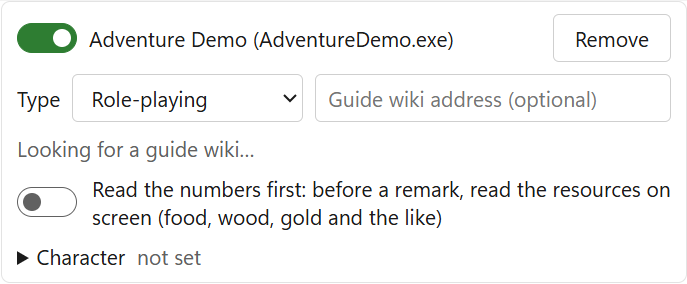
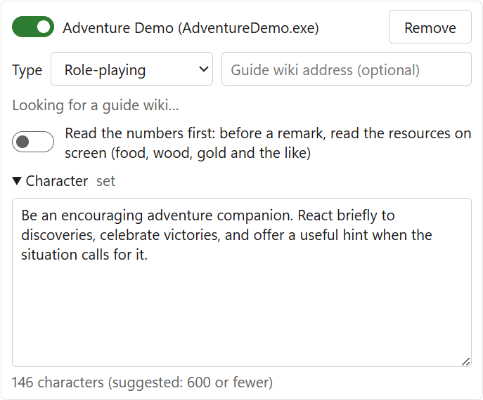
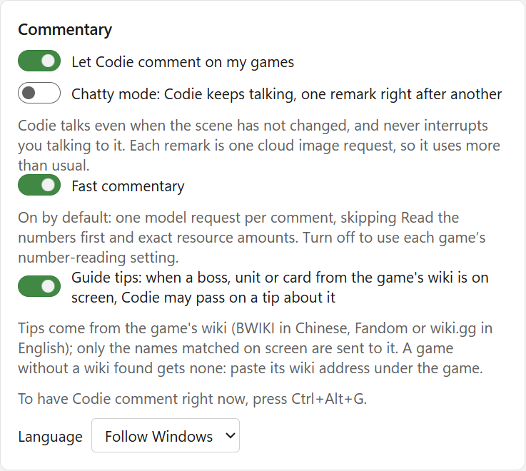

# Codie Game Buddy 使用说明

让 Codie 陪你一起玩游戏：观察当前游戏画面，适时说一句点评、提醒或鼓励；你也可以直接向 Codie 提问，让它结合画面回答。

本文按当前本地 **0.1.16** 代码整理，更新日期：2026-11-20。部分功能可能与旧安装包不同，请以实际安装版本的界面为准。文中的英文截图来自当前界面，示例游戏 Adventure Demo 为演示内容。

## 目录

- [1. 使用前准备](#1-使用前准备)
- [2. 安装与启动](#2-安装与启动)
- [3. 第一次设置](#3-第一次设置)
- [4. 日常使用](#4-日常使用)
- [5. 游戏与角色设置](#5-游戏与角色设置)
- [6. 解说与高级选项](#6-解说与高级选项)
- [7. 查看运行状态](#7-查看运行状态)
- [8. 背景资料与攻略提示](#8-背景资料与攻略提示)
- [9. 画面和数据如何使用](#9-画面和数据如何使用)
- [10. 更新与卸载](#10-更新与卸载)
- [11. 常见问题](#11-常见问题)

## 1. 使用前准备

| 项目 | 要求 |
|---|---|
| 电脑 | Windows 10 / 11，64 位 |
| Codie | 固件 1.6.0 及以上，已登录账号并可正常对话 |
| 网络 | 电脑和 Codie 位于可互相访问的同一局域网；游戏背景、攻略检索和云端看图需要相应的网络连接 |
| 游戏显示模式 | 推荐无边框窗口或窗口化；独占全屏可能截到黑屏 |
| 安装文件 | `CodieGameBuddySetup-<版本号>.exe` |

使用安装包时，无需另装 Node.js，也不需要安装 Claude Code 或 Codex。电脑、Game Buddy 和 Codie 都需要保持运行。

## 2. 安装与启动

1. 运行获取到的 Game Buddy 安装程序，完成安装。
2. 安装后，从桌面或开始菜单打开 **Codie Game Buddy**。
3. 首次运行会打开设置窗口。如已设置过，应用可能直接进入任务栏右下角的系统托盘。
4. 如果出现网络访问提示，请允许应用在你使用的可信局域网中通信。

若 Windows 显示安全提示，请先确认安装包来源可信。当前安装包未做代码签名。

**打开设置：**双击 Game Buddy 托盘图标，或右键图标选择「设置…」。图标可能收在任务栏的「^」展开区域中。

**关闭窗口与退出：**关闭设置窗口后，应用仍会在托盘运行。要完全退出，请在托盘菜单中选择「退出」。应用目前不默认随 Windows 启动。

## 3. 第一次设置

### 3.1 配对 Codie

1. 确认 Codie 已开机，并与电脑处于同一局域网。
2. 打开设置，在「Codie 设备」区域点击「搜索设备」。
3. 找到你的 Codie，点击对应的「配对」。
4. 将 Codie 屏幕上显示的 **6 位配对码**填入电脑端，点击「配对」。
5. 确认界面提示 Codie 已就绪。

即使这台电脑已通过 Claude Code 或 Codex 插件配对过 Codie，也需要在 Game Buddy 中完成配对，以授权这个应用使用设备。

配对码过期、已使用或输入错误时，重新点击「配对」获取新码。若提示固件过旧，先更新 Codie；若提示设备未登录，先在设备上登录账号。

### 3.2 添加游戏

**从运行中的程序添加：**

1. 先启动游戏。
2. 在设置的「游戏」区域点击「刷新」。
3. 从下拉列表中选择游戏，点击「添加」。
4. 确认游戏前面的开关已打开，再点击右下角的「保存」。

**手动添加：**

1. 展开「高级选项」。
2. 在「按程序文件名手动添加游戏」中填写程序文件名，例如 `Hades.exe`，以及游戏名称。
3. 点击「添加」，再点击「保存」。

程序文件名可在任务管理器的「详细信息」页查看。应填写实际显示游戏画面的进程，而不是只负责启动游戏的启动器。游戏名称尽量使用正式名称，方便查找背景和攻略资料。

### 3.3 验证能否使用

1. 将已添加的游戏切到前台。
2. 确认「让 Codie 解说我的游戏」已打开。
3. 按 **Ctrl+Alt+G**，查看 Windows 是否显示已收到请求的通知。
4. 等待 Codie 生成并播报；首次准备资料或网络较慢时可能需要更久。

能听到与当前画面相关的回应，就完成了基本设置。若无回应，先查看设置窗口顶部的状态和「最近错误」，再按第 11 节排查。

## 4. 日常使用

### 4.1 自动解说

默认情况下，Game Buddy 会在以下条件满足时发起解说：

- 解说总开关已开启。
- 当前前台程序匹配游戏列表中已启用的游戏。
- 已达到解说间隔，且画面变化达到设定阈值；第一次观察不要求先有画面变化。
- Codie 当前可以接收请求。

默认每 **3 秒**检查一次画面变化，两次自动解说之间至少等待 **60 秒**。这不是固定每分钟播报一次：画面没变化、设备忙碌或没有值得补充的内容时，Codie 可能保持安静。

切换到未启用的程序时，自动解说暂停。切回已启用的游戏后恢复判断。想暂时安静一下，可以关闭托盘菜单里的「解说」。

### 4.2 按快捷键让 Codie 看一眼

默认快捷键为 **Ctrl+Alt+G**。这是一次主动请求，不受自动解说开关、游戏列表、画面变化阈值和解说间隔限制，会尝试截取当前前台窗口。

- 收到请求后，Windows 会显示通知。
- 如果已有解说正在处理，会等待轮到这次请求时再截取新画面。
- 等待期间重复按键不会叠加更多请求。
- 等待期间切换了前台窗口，这次请求会取消；回到目标窗口后重新按即可。
- 快捷键是主动请求，可能打断当前对话；设备是否接受仍取决于当时状态。

### 4.3 边玩边向 Codie 提问

开启解说、且已启用的游戏位于前台时，Game Buddy 还会向 Codie 提供近期游戏画面，让你可以直接问：

- “你觉得我现在该注意什么？”
- “刚才画面里发生了什么？”
- “这个地方看起来有什么线索？”

画面刷新目标间隔约为 **1 秒**，实际速度受截图和网络影响，不保证实时同步。切换到其他程序、关闭解说或退出应用后，会请求清除游戏上下文；如果设备暂时不可达，旧上下文会在未刷新约 **20 秒**后过期。

### 4.4 话痨模式

开启「话痨模式」后，Codie 会在一次有效解说结束后尽快继续观察并接下一句，不再等待普通的画面变化和解说间隔。

它仍会给你与 Codie 的对话让路。一次生成没有返回语音文本、请求失败或设备忙碌时，也可能出现停顿。因此它不是连续无间隔播报。每次解说通常都涉及云端看图，用量会比普通模式高。

## 5. 游戏与角色设置

### 5.1 游戏开关与移除

每个游戏前面的开关决定是否允许自动解说该游戏。关闭开关可保留配置；点击「移除」则从列表删除。修改后点击「保存」。

多个游戏共用同一个程序文件名时，例如浏览器中的不同游戏，可以全部保留在列表，但同一时间只启用其中一个。应用按程序匹配，不能仅凭浏览器标签页判断你正在玩哪个游戏；离开游戏页面后应关闭该项或解说开关。

### 5.2 类型与攻略地址

「类型」可选自动、动作、策略、角色扮演、射击、MOBA、卡牌、其他。自动模式使用查到的游戏背景判断类型；不准确时可以手动调整。

「攻略 wiki 地址」可留空，让应用自动寻找。找不到时，可以填写该游戏攻略 wiki 的 HTTPS 页面地址，再保存。填写地址不保证网站一定兼容或能被访问。

### 5.3 角色设定

展开游戏下方的「角色设定」，用自然语言描述你希望 Codie 如何陪玩，例如：

> 做一个轻松、友善的冒险伙伴。发现新线索时提醒我，打赢战斗时简短鼓励，不要重复夸奖，也不要提前透露剧情。

建议不超过 **600 字**。超过建议长度会提示，但仍可保存；硬上限为 **4000 字**。留空时使用 Codie 原本的角色风格。

角色设定会用于该游戏的解说，以及游戏上下文生效期间的语音回答。它是表达风格的指令，不是更换音色的功能，也不能保证模型每次严格执行。

## 6. 解说与高级选项

设置窗口中的改动需要点击「保存」。托盘菜单中的「解说」「话痨模式」切换会立即生效。

### 6.1 解说选项

| 设置 | 默认状态 | 用途 |
|---|---|---|
| 让 Codie 解说我的游戏 | 开启 | 控制自动解说及游戏语音上下文；不禁用手动快捷键 |
| 话痨模式 | 关闭 | 更频繁地连续解说，不要求画面变化 |
| 快速解说 | 开启 | 每句跳过单独读数字的请求，侧重动作和整体趋势，不报精确资源数量 |
| 攻略提示 | 开启 | 尝试依据 wiki 和画面中识别到的名字给出简短提示 |
| 语言 | 跟随 Windows | 决定界面、解说语言和资料检索语言；也可手动选择 English 或简体中文 |

**快速解说与“先读数字”的关系：**

开启快速解说时，不执行游戏条目中的「先读数字」。关闭快速解说后，才按每个游戏的设置决定是否先读取屏幕上的资源数量。策略类型默认启用先读数字，其他类型默认关闭，也可以手动切换。

先读数字会增加一次模型请求，因此响应时间和用量通常也会增加。适合确实需要讨论食物、木材、黄金等资源数量的场景；它不能保证识别完全准确。

### 6.2 高级选项

| 设置 | 默认值 | 可调范围与说明 |
|---|---|---|
| 我和 Codie 说话时不要打断 | 开启 | 自动解说尽量不插入正在进行的对话；话痨模式始终让路 |
| 检查画面变化的间隔 | 3 秒 | 1–30 秒；只调整本地变化检测，不调整游戏语音上下文的独立刷新频率 |
| 两次解说至少间隔 | 60 秒 | 15–600 秒；嫌解说频繁时调大，话痨模式有独立行为 |
| 画面变化阈值 | 12 | 1–64；越大，要求画面变化越明显，不代表百分比 |
| 快捷键 | Ctrl+Alt+G | 可换成其他组合；保存时会提示是否被其他程序占用 |
| 手动添加游戏 | — | 按程序文件名和游戏名称添加 |

首次使用建议保留默认值。想更安静，先增大解说间隔；想让 Codie 更积极陪聊，再尝试话痨模式。

## 7. 查看运行状态

托盘图标的形状和角标分别表达工作状态与连接状态，不再是旧版本的单一彩色方块。

| 显示 | 含义 |
|---|---|
| 手柄配声波 | 正在截图、分析、生成或播放解说 |
| 休息月亮 | 暂停、等待前台游戏、等待画面变化或等待解说间隔 |
| 绿色角标 | 设备已就绪；不代表此刻正在播报 |
| 黄色角标 | 需要完成配对或授权 |
| 灰色角标 | 正在连接或设备离线 |

鼠标悬停托盘图标，或查看设置窗口顶部，可看到更具体的状态：正在截取画面、正在分析、正在生成或播放、等待下次解说、等待画面变化等。

「正在生成或播放」覆盖了生成和设备播放阶段，不能据此判断音频已经开始播放。「最近错误」会保留最近一次失败的信息，便于排查。

托盘右键菜单还提供「设置…」「检查更新」「退出」等入口。

## 8. 背景资料与攻略提示

### 8.1 游戏背景

应用按游戏名称查找世界观、剧情和角色等简短资料，并缓存在本机。简体中文优先查萌娘百科，必要时回退到维基百科；英文使用英文维基百科。

资料准备是异步的，新游戏刚添加时可能尚未就绪。游戏名称越准确，越容易找到对应资料。模型会被要求避免剧透和没有依据的说法，但仍可能识别或理解错误。

### 8.2 攻略提示

中文通常寻找 B 站 BWIKI，英文寻找 Fandom 或 wiki.gg。应用尝试识别画面中出现的 Boss、单位、卡牌等名字，再检索相应页面，给出一句相关提示。

要得到提示，通常需要：攻略提示已开启、找到可用 wiki、页面资料已准备好，以及画面中的名字能被识别。没有满足这些条件时，普通解说仍可继续。

Windows 需要具备相应语言的文字识别能力。如果缺少，可在 Windows 的语言设置中添加相关语言及文字识别组件。网站不可达或页面结构不兼容也会影响检索。

## 9. 画面和数据如何使用

| 数据或操作 | 使用方式 |
|---|---|
| 自动解说的画面变化检测 | 本机计算，不因每次检测而上传图片 |
| 发起解说时的截图 | 发给 Codie，由设备及其所使用的模型服务处理 |
| 游戏语音对话的画面上下文 | 在解说开启且已启用游戏位于前台时，独立刷新截图给 Codie；即使当前没有主动解说，也可能发送 |
| 手动快捷键截图 | 可截取未加入游戏列表的当前前台窗口；按键前请确认窗口内容 |
| 游戏背景检索 | 向相应百科发送游戏名称等查询信息，资料缓存在本机 |
| 屏幕文字识别与词条检索 | 文字识别在本机进行，匹配到的词条名或页面名可能用于外部网站查询 |
| 自动解说记录 | 解说请求不写入设备的聊天历史、记忆和日记；应用会在运行期间暂存近期解说，用于减少重复，退出后清除 |
| 你主动发起的语音对话 | 属于 Codie 自身的对话流程，不等同于自动解说“不保留”的请求 |

关闭自动解说会停止游戏上下文的持续刷新，但手动快捷键仍可发起截图。需要完全停止使用时，可从托盘退出应用。

电脑与 Codie 使用局域网明文 HTTP / WebSocket 通信。请在可信网络使用，并注意游戏窗口或快捷键目标窗口中是否包含私人内容。

## 10. 更新与卸载

### 10.1 更新

安装版通常在启动约 15 秒后、之后每隔 6 小时检查更新。也可以右键托盘图标，选择「检查更新」。

新版本下载完成后，选择「重启并更新到…」才会开始安装。如果提示需要登录，打开更新登录入口，使用具备下载权限的账号登录。能否获取更新取决于更新源和网络是否可用。

也可以运行新版本安装程序覆盖更新，通常无需先卸载旧版本。开发源码启动的应用可能未配置自动更新，应使用安装包验证更新功能。

### 10.2 卸载与设置保留

在 Windows「设置 → 应用 → 已安装的应用」中找到 **Codie Game Buddy** 并卸载。设置可能保留，便于重新安装。

默认的应用设置目录为 `%APPDATA%\codie-game-buddy`。设备配对信息由用户目录下的 `.codie` 共享保存，Claude Code / Codex 的 Codie 插件及其他 Codie 应用也可能依赖它；不要为了重置 Game Buddy 随意删除整个共享目录。

## 11. 常见问题

| 问题 | 建议处理 |
|---|---|
| 应用打开后没有窗口 | 查看任务栏右下角托盘，双击图标或右键选择「设置…」；重复启动也会打开已有实例的设置 |
| 搜索不到 Codie | 确认设备开机、网络可互通；检查防火墙、访客网络和路由器 AP 隔离 |
| 固件过旧或设备未登录 | 将 Codie 升级到 1.6.0 或以上，并在设备上登录账号后重新配对 |
| 已配对但仍显示离线 | 检查设备与网络状态；必要时在 Game Buddy 内重新配对 |
| 游戏不在下拉列表 | 先打开游戏并刷新；仍找不到时，用实际游戏进程的 `.exe` 文件名手动添加 |
| 自动解说一直不说话 | 检查总开关、游戏开关、是否已保存、游戏是否在前台、间隔和画面变化条件，再看顶部状态与最近错误 |
| 界面显示“等待画面变化” | 当前变化未达到阈值；继续游戏，或按快捷键主动请求 |
| 截不到画面或画面是黑的 | 改用无边框窗口或窗口化；确认目标窗口没有最小化且不是受保护内容 |
| 快捷键无效 | 在高级选项更换组合并保存，查看是否提示被占用；确认请求未因切换前台窗口而取消 |
| 已收到快捷键通知，却没有立即播报 | 通知只表示请求已收到；可能在等待前一轮结束、模型生成或设备响应 |
| “先读数字”打开后仍不读资源 | 检查快速解说是否开启；先关闭快速解说，单独读数字才会生效 |
| 没有攻略提示 | 检查攻略开关、wiki 来源、网络和文字识别能力；需要画面中有能匹配到的名称 |
| Codie 回答落后于游戏画面 | 截图、上传、生成和播放均有延迟；它不适合需要逐帧实时判断的操作指挥 |
| 解说重复或内容不准确 | 可调整间隔、游戏名称、类型及角色设定；减少重复依赖模型理解，不能完全杜绝 |
| 关闭设置窗口后仍在说话 | 设置窗口关闭不等于退出；关闭托盘中的「解说」，或选择「退出」 |
| 检查更新失败 | 确认使用安装版、更新源可访问，且已完成必要的登录 |
